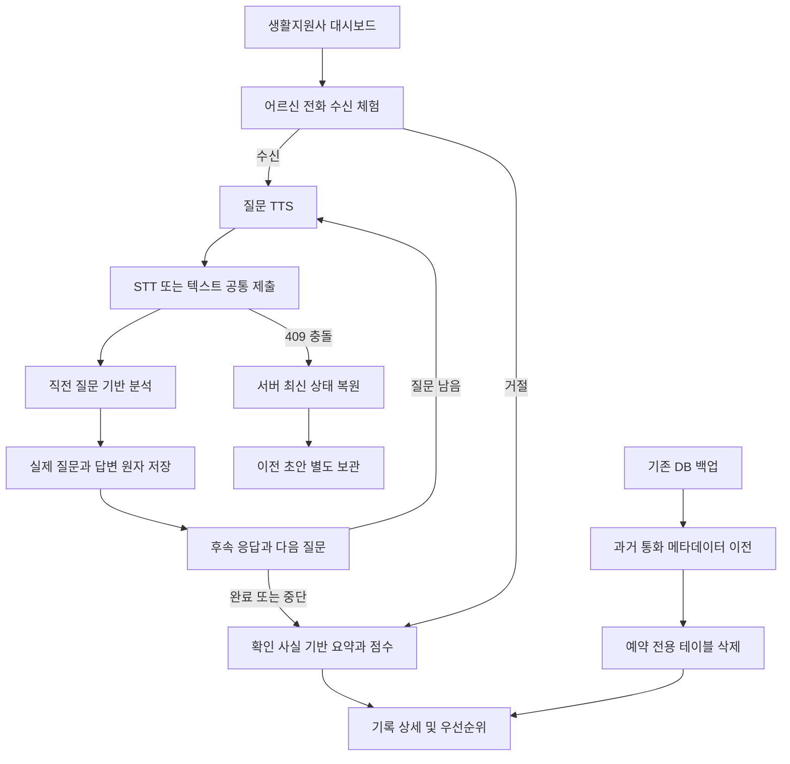

# 안심온 현재 구조와 기존 데이터 보존

현재 버전은 React/Vite + FastAPI + SQLite의 **일반 웹 안부전화 체험**이다. taewon에서 통합한 점수·확인 우선순위 및 이전 기록 조회는 유지하고, 전화 예약 기능은 제거했다. 예전 통합 검증 문서는 당시의 이력이며 현재 기능 목록은 이 문서와 README를 기준으로 한다.

## 화면과 API

| 화면 | 동작 |
|---|---|
| / | 생활지원사 대시보드, 어르신 목록, 최근 확인 점수 |
| /call/:elderId | 수신·거절·벨소리·STT/TTS·혼합형 대화·수동 종료 |
| /records | 최신순/확인 우선순위순, 실제 질문·답변·요약·점수 근거 |

FastAPI의 기존 `/api/residents`, `/api/questions`, `/api/calls`, `/api/dashboard`, `/api/health`를 유지한다. `/api/imported-records/{id}`는 가져온 이전 기록의 읽기 전용 상세다. 예약 메뉴·화면·스케줄러·예약 API는 없다. 이전 `?queue=` 링크에는 기능 종료 안내를 표시하고 일반 전화 체험 링크만 제공한다. 이전 예약 요청 본문(queue_id)은 422로 거부하여 다른 통화로 잘못 연결하지 않는다.

## 예약 데이터 마이그레이션

1. 서버 시작 시 기존 DB를 SQLite backup API로 `ansimon.db.backup-<UTC시각>`에 보관한다. ANSIMON_DB를 사용하면 해당 경로 옆에 백업한다.
2. 기존 `scheduled_calls`에서 과거 통화 별칭·예정 시각을 `calls.recipient`, `calls.scheduled_at`에 보존한다.
3. `scheduled_calls`, `care_schedules`를 자식 테이블부터 삭제한다.
4. 통화·답변·재질문·분석 상태·가져온 기록·원본 통계 아카이브는 유지한다.
5. 다시 시작해도 예약 테이블을 생성하지 않는다. 중간 실패 시 이전/삭제 작업을 savepoint로 롤백한다.

활성 예약·미처리 예약 회차는 더 이상 사용하지 않는다. 백업에는 원래 테이블이 남는다. 외부 원본 taewon DB 자체는 자동으로 변경하지 않는다. `residents.call_time`은 이전 스키마 호환을 위해 남지만 현재 화면이나 예약 처리에 사용하지 않는다.

DB 백업과 마이그레이션은 **사용자 PC에서 새 백엔드를 시작할 때** 적용된다. 이 작업 환경의 검증은 임시 DB로 수행했고 사용자의 실제 PC DB에 접근하지 않았다. 사용자 DB 파일은 배포하지 않는다.

## 이전 taewon 통화 기록 가져오기

서버를 먼저 Ctrl+C로 종료하고 프로젝트 루트 PowerShell에서 실행한다. `$sourceDb`는 실제 파일 경로로 바꾼다. 원본과 대상 DB는 달라야 한다.

```powershell
$sourceDb = "C:\원본폴더\ansimon\ansimon.sqlite3"
.\backend\.venv\Scripts\python.exe .\backend\import_taewon.py --source "$sourceDb" --target ".\backend\ansimon.db" --dry-run
.\backend\.venv\Scripts\python.exe .\backend\import_taewon.py --source "$sourceDb" --target ".\backend\ansimon.db"
```

원본은 읽기 전용으로 열고 스냅샷을 만든다. 기존 통화 records는 원래 요약·점수를 유지해 중복 없이 가져오고, 추가 통계/메타데이터는 legacy_archive에 원문 행으로 보존한다. 원본 예약 행도 과거 원문 아카이브로만 보존하며 활성 예약 테이블을 만들거나 예약을 복구하지 않는다. 같은 ID의 통화 내용이 바뀌면 덮어쓰지 않고 오류로 알려준다.

## 점수와 대화

현재 점수와 긴급 처리의 기준은 [review-v2](REVIEW_V2.md)이며, 아래 taewon 가중치 설명은 이전 기록 호환에 해당한다.

점수는 taewon의 항목별 가중치와 서버에서 확인된 사실을 사용한다. 같은 항목을 중복 합산하지 않고, 정정된 사실을 반영한다. 통화 중 점수는 미확정이다. 위험 표현은 직접 119 연락 안내를 제공하며 자동 신고를 하지 않는다. 점수는 시연용 확인 순서이며 의료적 판단이 아니다.

대화와 초안·충돌 복구의 상세는 [대화 설계](conversation-design.md), 실행 명령은 [README](../README.md), 이번 결과는 [수정 보고서](CALL_REPAIR_REPORT.md)를 참고한다.


