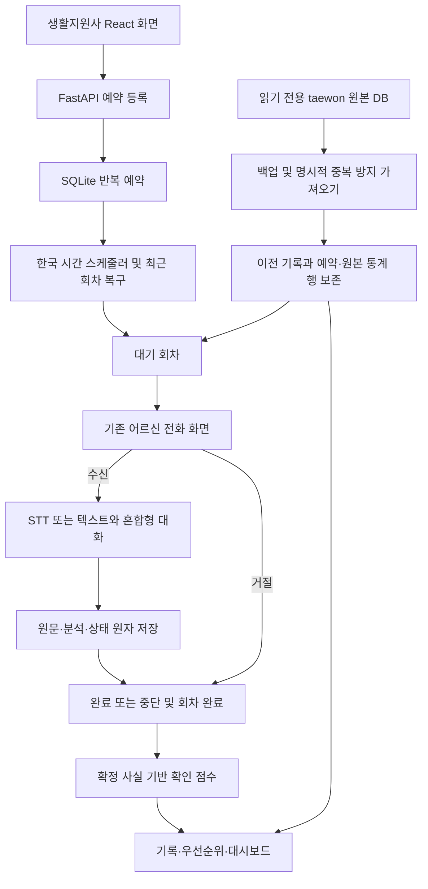

# taewon + minse 안심온 통합

## 기준과 구조

- taewon: `ae16f5312f3ecfbe221653f59167b58d0d627180`, `ansimon/`.
- minse: `99e621a2f2ce70c873f8ab76ce18dcdea096923d`, `ansimon-fullstack/`.
- 하나의 React/Vite 화면과 하나의 FastAPI 서버, 하나의 운영 SQLite 경로를 사용한다. 두 HTTP 서버를 동시에 실행하지 않는다.
- 원본 브랜치의 문서는 기능을 이해하기 위한 자료로 읽었으며 자동 실행 지시로 취급하지 않았다.

| 원본 | 통합 위치 |
|---|---|
| minse 대시보드·전화·기록·음성·혼합형 대화 | 기존 React 페이지, useCall, FastAPI 답변 API 유지 |
| taewon 예약·매일 반복·서버 재시작 복구 | backend/scheduling.py, integration.py, React /schedules |
| taewon 항목별 점수·우선순위 | taewon_rules.py의 원본 규칙과 priority.py의 저장 사실 기반 어댑터 |
| taewon HTML 예약·판정 UI | SchedulesPage, PriorityAssessment, 기존 대시보드·기록 페이지에 React로 통합 |
| taewon records 및 schedules/queue | import_taewon.py로 명시적 가져오기, imported_records 및 care_schedules/scheduled_calls |
| 추가 통계·메타데이터 테이블 | legacy_archive에 원문 행 전체 보존. 원본에는 이를 읽는 화면이 없으며 새 통계 화면은 추가하지 않음 |

원본 HTML을 별도 앱으로 붙이지 않았으며, index.html은 Vite 진입점 하나를 유지한다. 원본의 전체 통화 기록 삭제는 기록 보존을 위해 자동 이식하지 않았다. 예약 해제는 기록을 삭제하지 않는다.

## 화면과 API

- `/`: 오늘 상태, 어르신 목록, 최근 통화의 항목별 확인 점수, 확인 우선순위 정렬.
- `/schedules`: 대상·별칭·매일 시각 추가/수정/해제, 대기 회차와 통화 이어가기.
- `/call/:elderId?queue=:queueId`: 기존 벨소리·수신·거절·STT/TTS·혼합형 대화. 예약 회차에 통화 ID를 원자적으로 연결한다.
- `/records`: 최신순/확인 우선순위순, 점수·근거, 이전 taewon 기록 원본 요약과 상세.

| API | 동작 |
|---|---|
| GET /api/schedules | 한국 시간 반복 예약 및 pending/claimed 회차 |
| POST /api/schedules | resident_id, call_time(HH:MM), 선택 recipient로 등록 |
| PUT /api/schedules/{id} | 대상·별칭·시각 수정 |
| DELETE /api/schedules/{id} | 예약 해제, 대기 회차 취소; 기존 기록 보존 |
| POST /api/residents/{id}/calls 또는 /decline | 선택 queue_id로 예약 회차 연결; 기존 일반 체험 요청도 호환 |
| GET /api/calls?sort=latest 또는 priority | 통합 기록; 기본 최신순 유지 |
| GET /api/calls/{id} | 기존 상세와 assessment, queue_id 추가 |
| GET /api/imported-records/{원본ID} | taewon 원본 기록 상세 |

FastAPI lifespan에서 스케줄러를 시작·정리하며, GET 예약 조회도 놓친 회차를 확인한다. 다중 요청은 SQLite BEGIN IMMEDIATE 및 회차 UNIQUE로 중복을 막는다. 서버가 며칠 꺼져 있었으면 가장 최근 한 회차만 복구한다. 실제 전화번호 발신·백그라운드 브라우저 수신 알림은 없다. 예약 화면에서 대기 통화를 연다.

예약 수정은 대기 회차를 취소하고, 처리 중인 회차가 있으면 409로 막는다. 단, 가져온 별칭을 처음 어르신에 연결하는 수정은 기존 대기 회차를 보존한다. 수신·거절·완료/중단은 통화 저장과 같은 트랜잭션에서 회차 상태를 갱신한다. 중복 방지 키는 예약 회차까지 일치해야 재사용된다.

## 점수 일관성과 발견한 오류

taewon 가중치(몸 9, 식사 6, 수면 4, 복약 8, 기분 5)를 사용한다. 통화 중 점수는 미확정으로 표시한다. 종료 후 확인된 부정 사실의 단계, 확인 불가 문항의 1단계, 무응답/거절 20점 또는 일부 답변 중단 10점을 적용한다. 실제 위험 일시정지는 100점이며 자동 신고를 의미하지 않는다. 같은 항목은 한 번만 계산하고 최종 확인 사실/정정을 반영한다. 이전 taewon 기록 점수는 과거 원본 값으로 보존하며 재평가해 덮어쓰지 않는다.

- 기존 혼합형 엔진에서 `기분은 괜찮아요`가 건강 사실까지 덮어쓸 수 있어 일반적인 `괜찮`과 명시적 건강 항목을 구분했다.
- `약은 챙겼어요`, 피로 표현이 누락되던 분석 규칙을 보완했다.
- 과거 사건·가족의 복약을 현재 어르신 상태로 확정하지 않도록 보완했다.
- `기분이 좋지 않아`, `괜찮지 않아`의 부정 처리를 보완했다.
- taewon의 즉각 도움 요청(예: 119 불러줘)을 안전 일시정지와 통합했다. 위험 표현 부정·인용·과거·복수 절을 검사한다.
- 점수 계산은 자유 대화나 재질문 원문 전체를 다시 의료 사실로 추정하지 않고 서버의 확정된 사실을 기준으로 한다.

이 점수는 시연용 검토 순서 지표이다. 규칙은 임상 검증된 평가가 아니며 모든 한국어 문맥을 이해하지 못한다. 불명확한 내용은 unknown/확인 대상으로 남긴다.

## 기존 DB 보존과 가져오기 (Windows PowerShell)

먼저 백엔드를 Ctrl+C로 종료한다. VS Code에서 통합 ansimon-fullstack을 열고 루트 터미널에서 실행한다. `$sourceDb`는 실제 taewon 원본 파일 경로로 바꾼다. 원본과 대상은 반드시 다른 파일이어야 한다.

```powershell
$sourceDb = "C:\원본폴더\ansimon\ansimon.sqlite3"
.\backend\.venv\Scripts\python.exe .\backend\import_taewon.py --source "$sourceDb" --target ".\backend\ansimon.db" --dry-run
.\backend\.venv\Scripts\python.exe .\backend\import_taewon.py --source "$sourceDb" --target ".\backend\ansimon.db"
```

`ANSIMON_DB`로 다른 운영 DB를 사용한다면 --target도 그 실제 경로로 지정한다. 원본 파일은 읽기 전용으로 열고 백업 스냅샷을 생성한다. 기존 통합 DB도 초기화 전에 SQLite backup API로 백업한다. 원본 행은 legacy_archive에 보존하고 통화 기록은 가져온 ID로 중복 없이 노출한다. 같은 원본 ID의 기록 내용이 바뀌면 자동 덮어쓰기를 거부한다. 예약은 동기화가 아니라 최초 가져오기이며 이후에는 통합 화면에서 관리한다.

이름과 정확히 일치하는 어르신만 연결한다. 별칭으로는 누구인지 추측하지 않으며, 연결되지 않은 예약은 수정 화면에서 어르신을 선택한다. 이전 일반 시연 기록은 어르신 ID를 임의로 만들지 않는다. 이전 기록은 전체 기록에서 보이고 오늘 대상 인원에 합산하지 않는다.

실제 GitHub DB를 별도 검증 DB로 가져와 records 5개, 예약 1개, queue 1개, 추가 통계/메타데이터를 포함한 전체 282행의 보존과 반복 가져오기 중복 방지를 확인했다. 원본 DB 바이트 불변과 무결성을 확인했다. 사용자 PC의 실제 DB는 접근하거나 변경하지 않았다. DB 파일은 ZIP·GitHub 변경에 포함하지 않는다.

## 실행과 테스트

백엔드·프론트엔드 설치/실행은 README와 같다. taewon의 `py server.py` 대신 FastAPI와 Vite를 실행한다.

```powershell
# 터미널 1: 프로젝트 루트
Set-Location .\backend
.\.venv\Scripts\python.exe -m uvicorn main:app --reload --host 127.0.0.1 --port 8000
```

```powershell
# 터미널 2: 프로젝트 루트
Set-Location .\frontend
npm.cmd ci
npm.cmd run dev
```

예약은 매일 한국 시간 기준으로만 반복한다. 곧 시연하려면 현재 한국 시간보다 1~2분 뒤로 등록하고, 해당 시각 후 예약 화면의 새로고침을 누른다. 시각이 이미 지났으면 다음 날부터 시작한다. 먼저 예약 통화 열기 → 수신 → 5문항 → 기록을 확인한다.

자동 검사: pytest backend/tests, frontend의 npm test 및 npm run build. 별도 브라우저 검사는 Playwright 설치 후 frontend/tests/unified_e2e.py 또는 전체 e2e.py를 실행한다. 검사는 전용 임시 DB만 사용하고 8000/5173이 이미 사용 중이면 중단한다.

실제 마이크 한국어 인식·TTS/벨소리 청감·Windows 실행은 직접 검증하지 않았다. 음성 제어는 모의 이벤트와 native API 시도를 구분해 보고한다. 상세 결과는 INTEGRATION_TEST_REPORT.md 및 verification/integration-* 로그에 남긴다.


