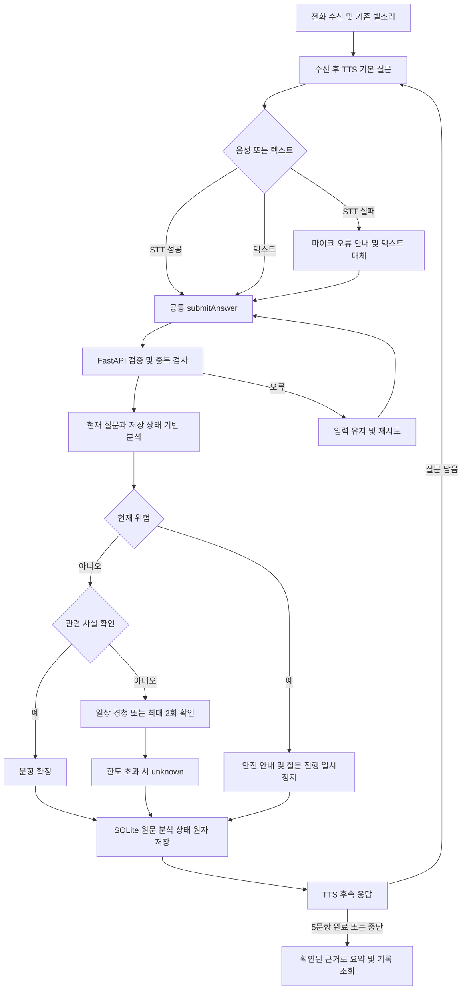

# C형 혼합형 안심온 대화 설계

기존 React/FastAPI/SQLite 및 `/api/calls/{id}/turns`를 유지한다. React는 `engine: hybrid`와 입력 출처 `text` 또는 `stt`를 전송한다. 기존 API 소비자는 생략 시 legacy 동작을 유지한다. 한 번 hybrid 상태가 생성된 통화는 서버의 hybrid 상태를 계속 사용한다. 유료 API나 로컬 모델 설치는 필요 없다.

## 질문 및 발화 분석

건강·식사·수면·복약·기분의 기존 5문항을 유지한다. 짧은 긍정/부정은 현재 질문 항목에 연결한다. 부분/중립, 복수 정보, 정정, 이중 부정, 과거/미래, 가족 이야기, 감정, 신체 증상, 위험, 도움 요청, 반복 요청, STT 오류, 침묵, 거부 및 AI에게 묻는 발화를 규칙으로 구분한다. 단서가 없는 간접 표현은 확정하지 않는다. 가족이 반찬을 가져왔다는 말만으로 식사 완료를 추정하지 않는다.

`normalizer` → `entity_extractor` 및 `risk_detector` → `intent_classifier` → `dialogue_manager` → `response_generator`로 분리한다. 분석·응답 인터페이스는 순수 함수이며 이후 로컬 모델 어댑터로 교체 가능하지만 현재는 모델이 없다.

## 상태와 저장

`hybrid_state`에 통화별 현재 index/count, 완료/확인 불가 항목, attempt, 확인 횟수, 일상 대화 횟수, 사실과 원문 근거, 감정 신호, 도움 요청, 최근 발화, 직전 응답, 위험 및 안전 일시정지를 JSON으로 보존한다. 통화 상태 자체는 기존 calls에 저장한다. `hybrid_events`에 원문·입력 출처·의도·사실·불확실 정보·위험·응답·행동·시간을 보존한다. 기존 turn_attempts와 최종 turns도 함께 저장하므로 기존 기록 화면을 유지한다.

모든 저장은 기존 BEGIN IMMEDIATE 트랜잭션에 포함된다. 기존 `(call_id,question_index,attempt)` 및 요청 키 중복 방지와 저장 응답 유실 재시도를 유지한다. GET 통화 상세의 dialogue_state로 새로고침을 복원하며 analysis_events에 분석 이력이 추가된다. 기존 DB는 시작 시 백업하며 테이블을 추가하고 기존 데이터를 삭제하지 않는다.

## 전환과 예외

일반 일상 이야기 통화당 기본 2회 (`ANSIMON_DAILY_LIMIT`, 음이 아닌 정수), 이후 기본 질문으로 복귀한다. 문항별 확인 질문 2회 이후 세 번째 불명확 응답은 unknown으로 확정하고 다음 문항으로 이동한다. 대화 거부는 해당 문항을 unknown으로 넘긴다. 과거 식사나 미래 계획을 오늘 완료로 저장하지 않는다. 입력 출처 stt_error/silence 이벤트는 의미 모호성과 분리하며 의미 확인 횟수를 소비하지 않는다. UI의 STT 실패는 기존 안내와 텍스트 전환을 유지하며 자동으로 서버 답변을 만들어 전송하지 않는다.

빈 답변은 422, 저장 실패는 입력을 유지해 재시도한다. 입력 중 초안 자체는 새로고침 보존 대상이 아니다. 중단 시 저장된 답변과 분석은 남는다.

## 위험

위험 표현을 먼저 검사한다. 현재 위험이면 safety_pause로 기본 문항 진행을 중단하고 직접 119 또는 가까운 사람에게 도움을 요청하도록 안내한다. 자동 신고는 하지 않는다. 과거·인용 단서나 부정 표현이 있으면 현재 위험으로 단정하지 않고 필요 시 확인한다. 안전 일시정지는 통화 종료까지 유지되며 자동 안전 해제나 진단은 없다. 규칙은 임상 검증된 평가가 아니다.

## 흐름도

## 검증과 한계

`backend/tests/test_hybrid.py`에 요청 문장과 위험·API·복원·중복·완료·중단 사례를 포함한다. 기존 백엔드·프론트엔드 회귀 검사도 수행한다. 실행 결과는 작업 보고를 참고한다.

이 엔진은 정규식과 문맥 상태를 조합한 제한된 규칙 엔진이다. 모든 사투리·복합 부정·인용·시간 관계·간접 발화를 이해하지 못한다. 자유 생성 대화나 사실 추론은 제공하지 않는다. 복수 사실을 저장하지만 확인된 다른 항목을 자동 완료 처리하지 않고 각 기본 질문을 계속 확인한다. 실제 마이크와 한국어 TTS 청감은 실기기 검증이 필요하다.
