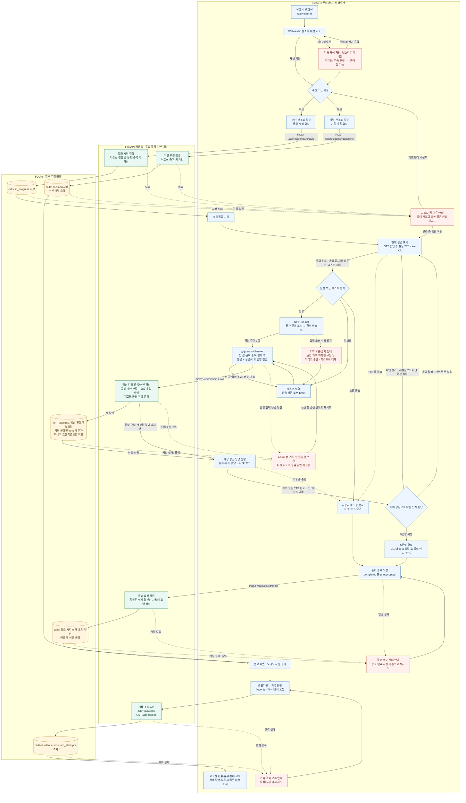
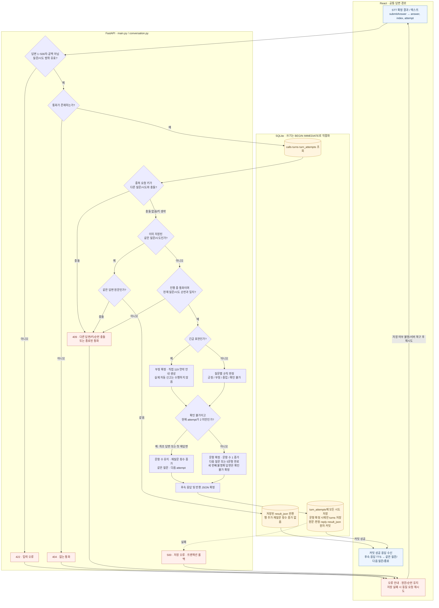

# 안심온 STT → 규칙 기반 대화 → 통화 기록 흐름

기준: 2026-11-09, `minse`의 앱 소스 커밋 `54e3163`. React·Web Speech API, FastAPI·규칙 엔진, SQLite를 구분했다. 아래 실선과 점선은 모두 **현재 구현된 처리**이며, 점선은 도중 종료 또는 오류 경로다. 여기서 ‘AI’는 유료 API/LLM이 아닌 규칙 기반 응답을 뜻한다.

[전체 흐름 SVG](conversation-flow.svg) · [답변 저장 상세 SVG](conversation-flow-storage.svg)

## 1. 전화 수신부터 생활지원사 기록 조회까지

신규 통화를 기준으로 그렸다. 기존 진행 중 통화가 있으면 수신 화면과 벨소리를 건너뛰고 저장된 답변·재질문 횟수·현재 질문을 복원한다. 잘못된 elderId나 초기 조회 오류에는 안내를 표시하고 통화를 시작하지 않는다.

**처리 순서 주의:** `assess()`가 답변 분류와 후속 응답을 먼저 만든다. 그 결과를 답변 원문과 함께 저장한 뒤 프론트엔드가 후속 응답을 읽는다. 따라서 ‘저장 후에 후속 응답을 생성’하는 구조로 그리지 않았다. 종료도 ‘종료 요청 → 요약 생성 → 상태·요약 커밋 → 종료 화면’ 순서다.

## 2. 답변 판정·재질문·중복 저장 방지 상세

- `index`는 0~4, `attempt`는 최초 답변 0·재답변 1·재답변 2다. 최대 두 번 재질문하므로 답변 기회는 세 번이다. 중간 STT 결과나 빈 답변은 서버 시도로 저장하지 않는다.
- 새 답변의 규칙 판정 안에서 긴급 표현을 우선 검사한다. 긴급 표현은 부정으로 확정하고 안내문을 만들며, 일반 문항 분류보다 우선한다. 위 그림의 긴급 분기는 이 판정 내부 처리를 풀어 쓴 것이다.
- `(call_id, question_index, attempt)` 유니크 제약과 쓰기 트랜잭션으로 동시/중복 저장을 막는다. 같은 순번·원문 재전송은 기존 응답을 반환하고 횟수를 소모하지 않는다.
- 선택 `Idempotency-Key` 충돌은 기존 답변 재사용 여부보다 먼저 확인한다. 키 충돌과 같은 순번의 다른 원문은 모두 409다.
- 모든 문항이 확인 불가여도 세 번씩의 답변 기회를 마치면 5문항 완료 상태로 종료할 수 있다. 완료는 ‘모든 답변이 긍정/건강 정상’이라는 의미가 아니다.

## 3. 오류·종료·조회 경로의 실제 동작

| 상황 | 현재 처리 |
|---|---|
| 잘못된 elderId / 어르신 없음 | 안내 화면. 수신 버튼·벨소리·통화 저장을 만들지 않음. 초기 API 실패는 다시 시도 가능. |
| 기존 진행 중 통화 | 같은 어르신의 통화를 조회하고 현재 질문·저장 답변·재질문 횟수를 복원. 수신 벨소리를 다시 울리지 않음. |
| 벨소리 차단/미지원 | 차단 시 ‘벨소리 켜기’, 미지원 시 안내. 무음 상태에서도 수신·거절 가능. |
| STT 권한 거부/무음/미지원/네트워크 오류 | 한국어 안내 후 텍스트 대체. 사용자는 마이크 재시작도 가능. 확정 결과만 공통 submitAnswer로 전달. |
| TTS 끄기/미지원/재생 오류/완료 이벤트 지연 | 텍스트 안내로 진행. TTS 발화 전 STT를 중단하고, 같은 대화 단계의 중복 발화를 막음. |
| 빈 값·500자 초과·한국어 조합 중 Enter | 프론트엔드에서 제출 방지. 백엔드도 빈 값·길이·순번을 검증하며 잘못된 요청을 성공으로 바꾸지 않음. |
| 답변 연결 실패/저장 실패/응답 유실/시간 초과 | 현재 화면에 전송 원문·순번 보존. 요청·응답 본문은 15초 제한 후 동일 요청 재시도. 서버에서 이미 커밋됐다면 기존 결과 반환. 저장 여부 불명인 입력은 편집을 잠금. |
| 409 충돌 | 자동 성공 처리하지 않음. 동일 요청으로도 해결되지 않는 다른 답변/순번 충돌은 화면에 계속 표시됨. 화면을 나갔다 같은 통화에 재진입하면 서버 상태를 복원. |
| 저장 중 종료 버튼 | 중복 동작을 막기 위해 API 처리 중 잠금. TTS 중에는 종료 가능하며 발화를 취소함. |
| 5문항 종료 | 마지막 후속 응답·종료 인사 TTS 후 completed 종료 요청. 실패하면 ‘완료 저장’으로 재시도. |
| 도중 종료 | STT·TTS를 멈추고 interrupted 종료 요청. 이미 저장된 답변을 유지하여 요약·종료 상태 저장. |
| 거절 | 별도 decline API가 calls에 declined·종료 시각·‘수신 거절’을 기록. 5문항 대화나 별도 AI 요약 단계는 실행하지 않음. |
| 종료 요청 재전송 | 이미 같은 상태로 종료됐으면 기존 결과 반환. 다른 종료 상태 변경은 409. |
| 단순 화면 이동/새로고침 | 요청·벨소리·STT·TTS·타이머 정리. 화면 이동 자체가 자동 통화 종료 요청은 아님. DB의 in_progress 통화는 재진입 시 복원. 아직 저장되지 않은 입력의 새로고침 보존은 미구현. |
| 기록 조회 | `/records`에서 목록과 상세 조회. 통화 시작부터 calls 행이 존재하므로 진행 중 통화도 조회할 수 있음. 목록 기본 최근 100개, 최대 500개 제한 유지. |

### 요약 생성 기준

`finish_call()`이 `summary_for()`로 **최종 분류가 긍정·부정·중립인 저장 답변의 실제 원문**을 연결한다. 확인 불가 원문·미확정 시도·과거 미분류 원문을 새 요약의 확인 내용에 넣지 않는다. 확인 불가 항목 이름은 별도로 표시한다. 의학적 진단을 만들지 않고, 긴급 표현에는 ‘직접 119 연락 안내문 생성·자동 신고 없음’만 기록한다. 실제 119 신고·전화 발신을 했다고 표시하지 않는다. 과거 완료 통화의 기존 요약을 소급 재작성하지 않는다.

### 구현 범위와 계획 구분

흐름도에는 구현된 웹 통화만 포함했다. 실제 전화망 발신/수신, LLM/OpenAI 대화 생성, 자동 119 신고, 미저장 초안의 영구 복원은 구현되지 않았으며 흐름도에 실행 단계로 넣지 않았다. 계획·준비 단계 항목은 현재 실행 흐름과 분리한다.

- **기존 README에 적힌 후속 준비 항목:** 사용자 로그인·접근 권한, 실제 전화/문자 사업자 연동, 운영 DB·배포·보존 정책 정비. [README의 후속 출시 준비 체크](../README.md)를 참고하며, 현재 구현으로 표시하지 않았다.
- **그 밖의 미구현 항목:** LLM 대화, 자동 119 신고, 미저장 초안의 영구 복원. 이 문서에서 새 개발 계획으로 확정하지 않았다.

실제 마이크·한국어 음성 출력의 환경별 검증 범위는 [STT/TTS 보고서](SPEECH_INPUT_REPORT.md)를 따른다.

## 4. 코드와 단계 대응

| 구현 단계 | 실제 파일·함수 |
|---|---|
| 수신/거절·종료 화면 | [CallPage.jsx](../frontend/src/pages/CallPage.jsx), [IncomingCall.jsx](../frontend/src/components/IncomingCall.jsx), [CallControls.jsx](../frontend/src/components/CallControls.jsx) |
| 벨소리·해제 | [useRingtone.js](../frontend/src/hooks/useRingtone.js) — useRingtone |
| 시작·복원·답변 전송·종료 요청 | [useCall.js](../frontend/src/hooks/useCall.js) — load, begin, decline, submitAnswer, finish, saveFinish. [api.js](../frontend/src/api.js) — HTTP 오류·시간 제한 |
| 질문·후속 응답 TTS | [synthesis.js](../frontend/src/speech/synthesis.js) — SpeechOutput.speak/stop/dispose |
| STT·실패 대체 | [recognition.js](../frontend/src/speech/recognition.js) — SpeechInput.start/stop/dispose |
| 텍스트·현재 질문·인식 표시 | [TextAnswerInput.jsx](../frontend/src/components/TextAnswerInput.jsx), [ConversationPanel.jsx](../frontend/src/components/ConversationPanel.jsx), [SpeechInputStatus.jsx](../frontend/src/components/SpeechInputStatus.jsx) |
| 요청 검증·DB 저장/조회·중복 | [main.py](../backend/main.py) — TurnInput, start_call, decline_call, add_turn, finish_call, calls, call_detail, db |
| 규칙 판정·후속 응답·요약 | [conversation.py](../backend/conversation.py) — QUESTIONS, assess, urgent, summary_for |
| 생활지원사 기록 조회/상세 | [RecordsPage.jsx](../frontend/src/pages/RecordsPage.jsx) — 목록 조회 및 상세 모달 |

## 5. Mermaid 검사 및 SVG

두 Mermaid 코드 블록은 동일한 소스로 파싱·SVG 렌더링하여 문법을 검사한다. SVG에서는 HTML foreignObject 대신 텍스트 라벨을 사용한다. 검사 결과·Mermaid 버전은 [검증 기록](verification/conversation-flow-validation.json)에 저장한다. 문서 링크와 SVG의 XML 구조도 함께 확인한다. 이번 변경은 문서·이미지뿐이며 앱 동작을 변경하지 않는다.

## 짧은 답변·기록·복구 수정 (2026-11-13)

짧은 응/어는 직전 질문이 단일 확인형일 때만 해석한다. 열린 질문이나 양자택일에는 임의로 긍정 값을 넣지 않는다. 잤어는 수면 사실/수면의 질 미확인으로 구분한다. 재질문은 단일 질문이며, 실제 출력 질문을 서버 이력에 보존한다.

입력은 sessionStorage에 통화·문항·시도별로 보관한다. 새로고침 시 같은 순번이면 복원하고, 이미 서버에 저장된 답변이면 중복 전송하지 않는다. 409는 서버 상세를 다시 조회한다. 이전 문항의 다른 초안은 별도 표시하고 새 질문에 자동으로 전송하지 않는다. 명시적 통화 종료 시 초안을 정리한다. 전화 예약 경로와 스케줄러는 제거했으며 일반 수신 체험과 기존 저장 흐름은 유지한다. 상세 검증은 [이번 보고서](CALL_REPAIR_REPORT.md)를 참고한다.
