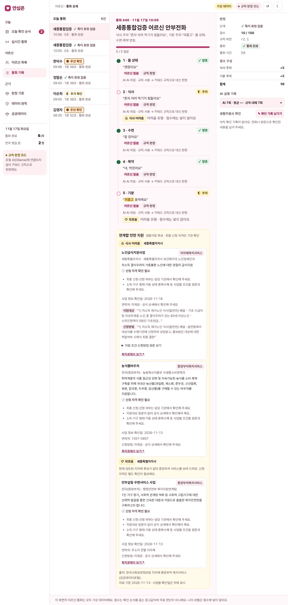
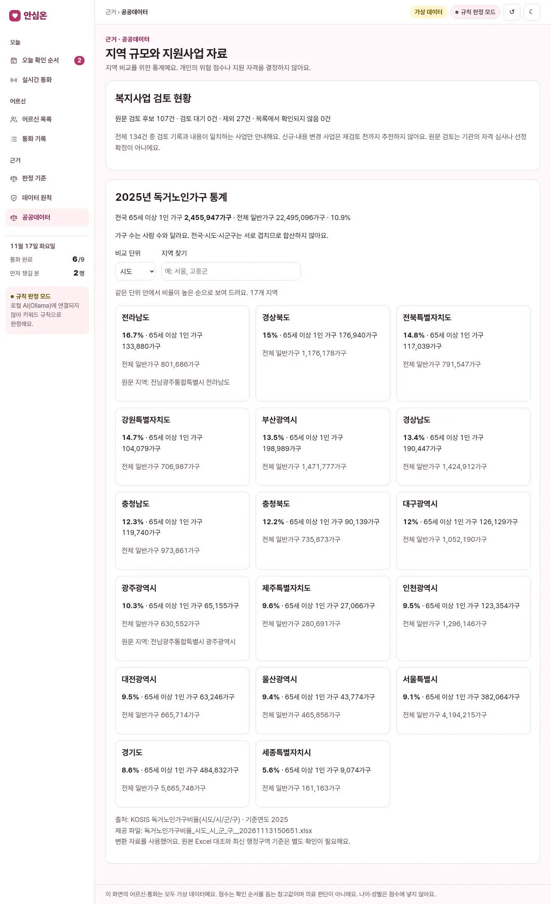
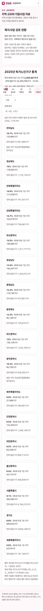

# minse 공공데이터 통합 검증 (2026-11-17)

## 범위

- 기반 main: `32f857034f275ae49d59814d3bffcc284a3eeb67`.
- 보존할 minse: `35c0d3823db970a6d0acb0e3418102c77bec5b80`의 `ansimon-fullstack/` 전체. 해당 경로의 diff 0건.
- 새 앱은 루트 `apps/`에 추가. 원래 앱 운영 인증·푸시·실제 전화망은 이번 F11 작업 범위가 아니다.
- 제공 ZIP의 JSON 세 파일은 원문 스냅샷으로 보존. 검토 분류는 별도 파일로 관리.

## 자동 검사

`ANSIMON_PYTHON=<저장소 밖 가상환경>/bin/python bash scripts/test-all.sh` 결과:

- API pytest: **220 passed** (원래 판정·통화 테스트와 신규 F11 회귀 테스트 포함).
- 웹 TypeScript 검사 + Vite build 통과.
- 앱 TypeScript 검사 + Vite build 통과.
- 앱 음성 단위 테스트 **29 passed**.
- `scripts/smoke_welfare.py`: 임시 DB · AI 끔, 5문항 완료 후 세종시 노인급식지원사업 반환 확인.
- 검토 CLI의 대기 목록 출력: 0건. 현재 134건 중 직접 지원 후보 107건, 제외 27건.
- 통계: 시도 수준 17개 지역 합계가 전국 2,455,947가구 / 22,495,096가구와 일치.

회귀 사례: 장례·급식도우미수당·종사자지원 제외, 주민 이용 급식소 유지, 신청 연령 경계, 신규·변경 내용 검토 대기,
사업별 조회일, 중첩 XML 연락처, 400자 이후 원문 보존, 사업 목록 누락, 갱신 실패·중복 페이지, 캐시 손상 시 이전 사업 부활 방지.
수집기 테스트는 HTTP 목업이며 실제 공공데이터 API 재수집은 아니다. 인증키가 제공되지 않아 기존 누락을 복원하지 않았다.

## 브라우저 통합 (실제 로컬 서버, 가상 어르신)

Headless Chromium, 웹 1440×1000·390×844, 어르신 앱 390×844.

1. 세종시 가상 어르신을 등록하고 생활지원사 웹에서 전화 걸기.
2. 어르신 앱에서 수신하고 몸 → 식사 → 수면 → 복약 → 기분 5문항 답변.
3. 식사: `혼자 차려 먹기가 힘들어요`, 기분: `외롭고 울적해요`.
4. 통화 완료 후 담당자 상세에 노인급식지원사업·농식품바우처·안부살핌 우편서비스 표시.
5. 공영장례 지원이 없는 것, 신청 자격 확인 필요·사업별 확인일·연락처 미제공 표시 확인.
6. 공공데이터 화면에서 시도 17개, 광주 검색 후 시군구 5개로 전환 확인.
7. 웹 두 크기에서 가로 넘침 없음, 표시된 텍스트 16px 미만 없음.

TTS/STT는 브라우저 테스트용 가짜 음성을 사용했다. 실제 마이크·실물 폰·Ollama 품질 확인을 뜻하지 않는다.

