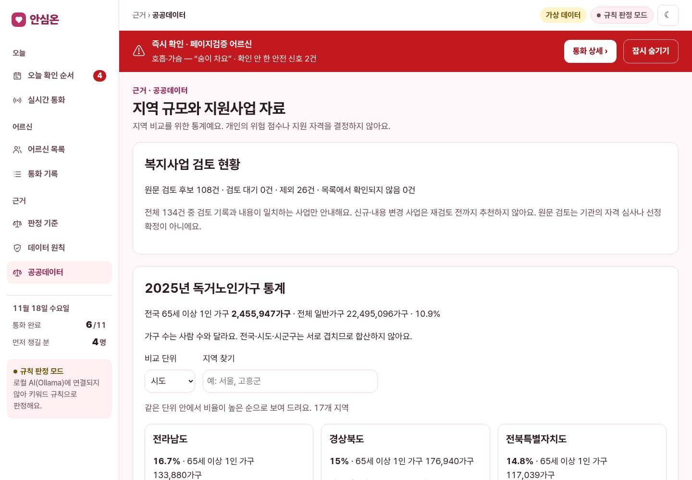
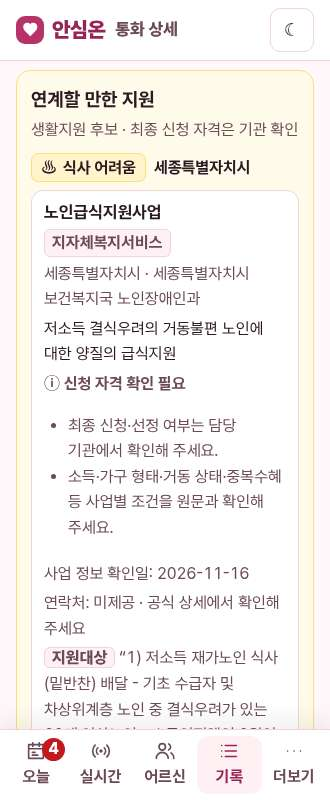

# main + 공공데이터 통합 검증 (2026-11-18)

## 기준

- 기준 main: `469d6e28bf4afcf406a4217f26140dc446fbc59f`.
- 입력 ZIP SHA-256: `1ec9e5d306f0595a06da257137b76b559ddc8ad138bbf3bb48f276acb8768fb6`.
- 원본 자료: 복지사업 고유 134건, KOSIS 2025년 지역 246행. 검토 후 직접 생활지원 후보 108건, 제외 26건.
- 원래 main의 PIN 인증·안전 알림·규칙 r3·통화 복구·진주빛 배경을 유지했다. 기존 minse 앱 폴더를 main에 넣지 않았다.

## 검사 결과

`ANSIMON_PYTHON=<저장소 밖 가상환경>/bin/python bash scripts/test-all.sh`:

- API pytest **316 passed** (최신 main 회귀 + F11/통합 회귀 + 민감도 평가 포함).
- 웹 TypeScript + Vite build 통과.
- 앱 TypeScript + Vite build 통과. 진주빛 배경 자산을 사용한 빌드 확인.
- 앱 음성 Vitest **30 passed**.
- 독립 `scripts/smoke_welfare.py`: 임시 DB에서 실제 PIN 로그인 → 발신 → 수신 상태 → 5문항 → 세종 급식사업 지원대상·신청방법 반환 통과.
- 변경 전 실패를 확인한 회귀: 함양군 사업의 거창군 오추천, 시흥 60세 이상 사업의 55세 오추천, 모델 미설치 준비 상태, 모순 AI 요약 덮어쓰기, 통화 50건 제한/필터, 재검토 시 지역·연령 초기화, 캐시 유실 시 예전 지자체 사업 재등장.
- 도봉구 실제 정기 안부확인 배달사업 복원: 외로움 65세 포함·64세 제외·식사 지원으로 오분류하지 않음.
- 새 공공데이터 API의 401·PIN 로그인 후 200 확인. 원래 main의 인증 회귀와 r3 외부 리뷰 테스트도 전체 검사에 포함.
- 수집기 검증은 HTTP 목업이다. 실제 API 인증키로 재수집한 결과가 아니다.

## 브라우저 통합

실제 로컬 API/Vite 서버, Headless Chromium, 가상 어르신. 담당자 PIN 인증은 켠 상태, 앱은 QR로 식별했다.

1. 담당자 웹에서 PIN 로그인 후 세종시 가상 어르신에게 발신.
2. 어르신 앱에서 수신 → 몸·식사·수면·약·기분의 답변 5개 → 완료.
3. 식사 `혼자 차려 먹기가 힘들어요`, 기분 `외롭고 울적해요`로 실제 규칙을 통과시켰다.
4. 담당자 통화 상세에 `노인급식지원사업`, `농식품바우처`, `안부살핌 우편서비스 사업`을 표시했다. 공영장례 지원은 나오지 않았다.
5. 신청 자격 확인 필요, 사업별 정보 확인일, 연락처 미제공·공식 상세 링크 확인.
6. 공공데이터 화면: 웹 1440×1000, 390×844, 330×700에서 가로 넘침 없음·표시 글자 16px 미만 없음.
7. KOSIS 시도 17개, 광주 검색 후 시군구 5개 전환. 시도 합계가 전국 2,455,947가구 / 22,495,096가구와 일치.
8. 통화 상세의 지원 원문을 펼친 330px 화면에서 가로 넘침 없음.
9. 50건을 넘는 통화를 만들어 웹의 다음 페이지 이동과 단계 필터를 확인했다. 첫 페이지 밖의 긴급 통화를 찾아 표시했다.

음성은 브라우저 테스트용 가짜 음성이다. 실제 마이크·휴대폰·Ollama 품질 검증을 뜻하지 않는다.

## 검토와 남은 범위

저장소의 독립 검토 규약에 따라 별도 에이전트가 읽기 전용으로 diff를 확인했다.
그 과정에서 재검토 CLI의 제한 초기화가 재현돼 수정·회귀 검증했으며, 캐시 유실 정책과 도봉구 실제 안부 배달 누락도 추가 점검했다.

실제 공공데이터 API 재수집, 원본 Excel 대조, 사회복지시설 API 연결, 기기 종료 상태의 원격 푸시, 기관별 실운영 권한 체계는 완료하지 않았다.
누락 연락처·잘린 원문은 채워 넣지 않고 표시한다. 신청 자격·원본의 최신성·실제 모델/휴대폰 동작에 대한 남은 한계는 [적용 문서](../공공데이터-적용.md)에 상세히 기록했다.
